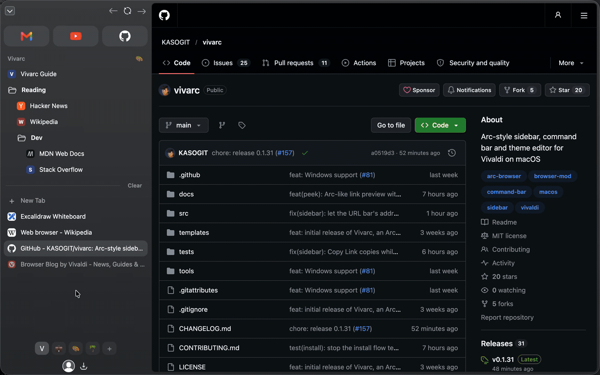
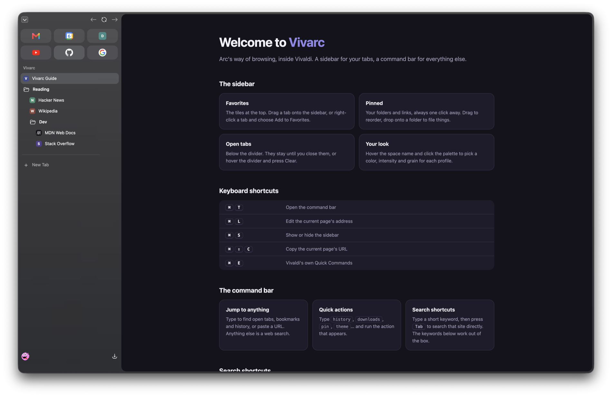
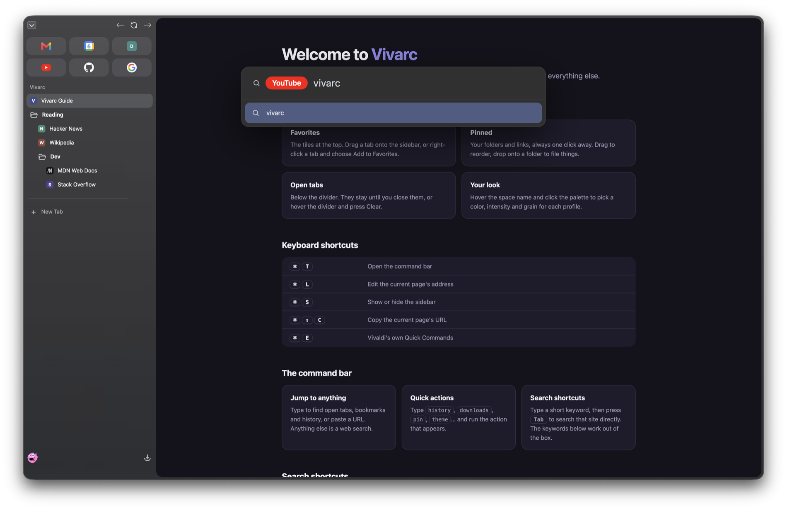
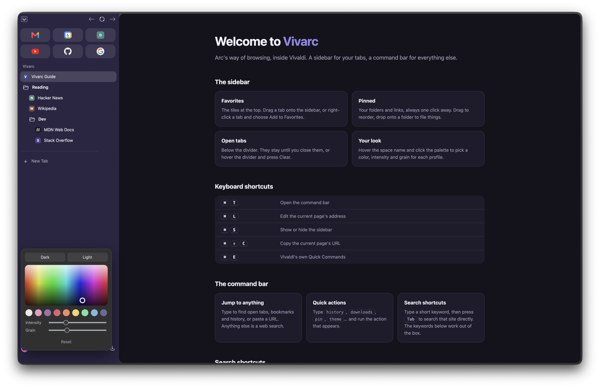

<h1 align="center">Vivarc</h1>

<p align="center">
  <b>Arc's sidebar and command bar, inside Vivaldi.</b><br>
  Favorites, pinned folders and open tabs in one panel. A Cmd+T (Ctrl+T on Windows) command bar with quick actions. A theme editor. One command to install, one to remove.
</p>

<p align="center">
  <a href="LICENSE"></a>
  
  
  
</p>

<p align="center">
  
</p>

> **Arc is being discontinued on December 22, 2026**, according to the announcement email The Browser Company sent. If you want to keep the sidebar and command bar workflow somewhere else, Vivarc gives you most of it in Vivaldi, free and open source.

## Install

No developer experience needed. It takes about two minutes.

### macOS

1. Open **Terminal** (press Cmd+Space, type `Terminal`, press Enter).
2. Paste this line and press Enter:

   ```sh
   /bin/bash -c "$(curl -fsSL https://raw.githubusercontent.com/KASOGIT/vivarc/main/install.sh)"
   ```

3. Follow what it says. It offers to close Vivaldi for you, and if macOS asks for a permission (**App Management**) it opens the right settings page and waits while you switch it on for Terminal.
4. Open Vivaldi.

Every profile gets the sidebar, and profiles you create later set themselves up the first time they open (the sidebar needs no restart, but Vivaldi reads keyboard shortcuts at launch, so the space and profile shortcuts work after the profile's next restart). Each profile starts with a few example favorites and pins so you can see how it works, and a new profile opens a short guide page.

Requires macOS and Vivaldi 8.x. If your Mac has never had developer tools, macOS shows an "Install" window the first time (it is Apple's free command line tools, which include Python); click Install, wait, then paste the line again.

### Windows

1. Vivarc needs Python 3. If you do not have it, open **PowerShell** (press Start, type `PowerShell`, press Enter) and run `winget install Python.Python.3.13`, then close and reopen PowerShell.
2. Paste this line in PowerShell and press Enter:

   ```powershell
   irm https://raw.githubusercontent.com/KASOGIT/vivarc/main/install.ps1 | iex
   ```

3. Follow what it says. It offers to close Vivaldi for you.
4. Open Vivaldi.

Requires Windows 10 or 11 and Vivaldi 8.x installed the default way (for your user). Use a normal PowerShell window, not "Run as administrator". On Windows the shortcuts use **Ctrl** where macOS uses Cmd (see [Shortcuts](#what-you-get)).

Every Vivaldi update on Windows installs into a new folder, which leaves Vivarc behind. The installer adds a small scheduled task (`Vivarc\Reapply`, every 30 minutes while you are logged in) that puts Vivarc back by itself and tells you to restart Vivaldi. Turn it off with `python ~\.vivarc\app\vivarc.py reminder off`.

### Troubleshooting

- **"Operation not permitted" or "macOS blocked writing into Vivaldi.app":** switch on Terminal under System Settings > Privacy & Security > App Management, then paste the line again. **Do not use `sudo`**: it does not help and can leave files only root can change.
- **Already used `sudo`?** Run `sudo chown -R "$(whoami)" ~/.vivarc` once, then paste the install line again (without `sudo`).
- **"Vivaldi not found":** Vivarc looks in `/Applications/Vivaldi.app` (Windows: `%LOCALAPPDATA%\Vivaldi\Application`, then `Program Files`). If yours is elsewhere, use the developer install below with `--app` (on Windows, the folder that contains `vivaldi.exe`, or `vivaldi.exe` itself; a portable copy without version folders works too). The Update and Uninstall launchers remember the `--app` and `--data-dir` you installed with.
- **Windows: "Cannot write into ... Vivaldi" or "Python was not found":** Vivaldi installed for all users lives under Program Files, which needs an administrator terminal; reinstalling Vivaldi for your user only avoids that. "Python was not found" means only the Microsoft Store shortcut is there: install Python as in step 1.

### For developers

```sh
git clone https://github.com/KASOGIT/vivarc.git && cd vivarc
./vivarc.py install       # also: apply, status, uninstall, import-arc
# Windows: python vivarc.py install
```

## Update, uninstall or start fresh

Both tools are small apps that the installer leaves in the `Applications` folder inside your home folder. To find them: in Finder press Cmd+Shift+H, then open `Applications` (not the one in the sidebar). Drag them to your Dock to keep them close. They open Terminal, so Terminal needs the **App Management** permission, the same one as at install (macOS asks, and the installer's steps apply again).

**Update, or bring Vivarc back after a Vivaldi update.** Vivaldi updates replace the app and remove Vivarc.
1. Double-click **Update Vivarc**.
2. It quits Vivaldi, fetches the latest Vivarc, puts it back and reopens Vivaldi.

**Uninstall.**
1. Double-click **Uninstall Vivarc**.
2. It quits Vivaldi, restores your settings, removes Vivarc and reopens Vivaldi. Your bookmarks, including the `Vivarc` folder, are never deleted, and you do not need to reinstall Vivaldi.

**Start fresh.** Run **Uninstall Vivarc**, then paste the install line from [Install](#install) again.

**From Terminal instead:**

```sh
python3 ~/.vivarc/app/vivarc.py update      # same as Update Vivarc
python3 ~/.vivarc/app/vivarc.py uninstall   # same as Uninstall Vivarc (add --purge to also delete ~/.vivarc)
python3 ~/.vivarc/app/vivarc.py status      # what is installed
```

**Update button.** When a new Vivarc release is out, a small **Update Vivarc** button appears above the space bar. Click it to update: Vivarc runs the same update as **Update Vivarc** (the first time, Vivaldi asks to open it: allow it). Right-click it for **Copy Update Command**, **What's New** (the release notes) or **Later** (hides it until a newer release). Vivarc asks GitHub at most every 12 hours; switch **Check for updates** off in Vivarc Settings to stop that and hide the button.

**Update reminder (optional).** The installer offers it. When a Vivaldi update removes Vivarc, a small dialog asks whether to bring it back. When a new Vivarc release is out you get a quiet notification, never a dialog. Switch it on or off with `python3 ~/.vivarc/app/vivarc.py reminder on` (or `off`).

**On Windows**, **Update Vivarc** and **Uninstall Vivarc** are in the Start Menu (type their name). They work as above. From PowerShell: `python ~\.vivarc\app\vivarc.py update` (or `uninstall`, `status`). After a Vivaldi update you normally do nothing: the scheduled task re-applies Vivarc and asks you to restart Vivaldi. When a new Vivarc release is out, an **Update Vivarc** button shows in the sidebar (see below).

## What you get

**One sidebar.** A favorites grid on top, your pinned folders below, a divider with *Clear*, then your open tabs. Drag and drop between all of them, nest folders, rename in place, right-click for everything. Removed items go to Vivaldi's bookmark trash. Like Arc, a pinned tab stays on its pin when you navigate inside it: the row shows a `/` and the title of the page you are on, and on hover you can jump back to the pinned page or separate the page you are on into its own tab. A tab playing sound shows a speaker on its row or favorite tile: click it to mute just that tab.

<p align="center">
  
</p>

**A command bar on Cmd+T.** It opens over the page you are on. Type to jump to an open tab, a bookmark or a history entry, paste a URL, or search.

<p align="center">
  
</p>

- **Search shortcuts.** Type `yt` then Tab to search YouTube. 18 are built in (`g`, `gm` Gmail, `gd` Drive, `gc` Calendar, `gh`, `so`, `npm`, `mdn`, `li`, `x`, `w`, `r`, `m`, `az`, `tr`, `d`, `b`). The search engine keywords you already set in Vivaldi work too.
- **Quick actions.** Type `history`, `downloads`, `pin`, `theme`, `private`, `guide`... and run it: View History, View Downloads, Pin This Tab, Add to Favorites, Collapse / Expand All Folders, Copy Current URL, **Split View** (side by side or top and bottom, like Arc), Duplicate, Mute, New Private Window and more.

**Settings.** Cmd+T, type `settings` (or right-click the sidebar, *Vivarc Settings…*) to switch features on and off live, per profile, including a **URL bar** always shown at the top of the sidebar like Arc (otherwise it appears with Cmd+L), **Archive inactive tabs** (closes tabs you have not opened for 1 hour to 7 days, like Arc; off by default; pinned links, favorites, split views and tabs playing sound are kept) and an optional **Liquid Glass** look (translucent sidebar, menus and command bar with an opacity slider from clear to frosted, following Apple's guidance; it falls back to solid surfaces with Reduce Transparency or Increase Contrast).

**A theme editor.** Hover the space name and click the palette: pick a colour, intensity and grain. Saved per profile, so each one gets its own look.

<p align="center">
  
</p>

**Shortcuts**

| macOS | Windows | Does |
|---|---|---|
| Cmd+T | Ctrl+T | Command bar |
| Ctrl+Tab, Ctrl+Shift+Tab | Ctrl+Tab, Ctrl+Shift+Tab | Tab switcher: the five latest tabs with thumbnails. Hold Ctrl and press Tab to move (hold Tab to speed up), let go of Ctrl to switch. A quick press goes to the previous tab. |
| Cmd+S | Ctrl+S | Hide the sidebar, or show it again. While it is hidden, move the pointer to the left edge of the window and it slides back in. |
| Cmd+Shift+C | Ctrl+Shift+C | Copy the page URL (with a toast) |
| Cmd+L | Ctrl+L | Edit the address |
| Cmd+E | Ctrl+E | Vivaldi's own Quick Commands |
| Cmd+Option+Left/Right | Ctrl+Alt+Left/Right | Previous/next space |
| Ctrl+Cmd+N | Ctrl+Alt+N | New space |
| Ctrl+Cmd+Left/Right, 1..9 | Ctrl+Alt+Shift+Left/Right, 1..9 | Previous/next profile, nth profile |

On Windows, Win+Ctrl+arrows belong to virtual desktops, so the profile keys add Shift instead. Ctrl+T, Ctrl+S and Ctrl+Shift+C take over New Tab, Save Page and Copy to Note (the command bar opens a new tab; Save Page stays in Vivaldi's menu).

**Also:** an importer for your Arc spaces and site icons, and a link preview like Arc's Peek (VividPeek, by [PaRr0tBoY](https://github.com/PaRr0tBoY/Awesome-Vivaldi), downloaded from upstream and verified at install).

**Link preview (Peek).** A link to another site, clicked in a pinned tab, opens in a floating window over the page; so does a link clicked with Option held (Alt on Windows) or held down with the middle mouse button. Esc or a click outside closes it, and the buttons on its right open it in a tab or in split view. Cmd+click (Ctrl+click) always opens a new tab. If links open in a small window and you did not want that, turn off **Link preview (Peek)** in **Vivarc Settings**, or change its shortcut there. `--no-peek` at install leaves it out entirely.

## Coming from Arc or Chrome

**From Chrome (or Safari, Firefox, Edge):** use Vivaldi's own importer, **File > Import Bookmarks and Settings…**, and most Chrome extensions install from the Chrome Web Store. The guide page that opens in a new profile covers this too. Imported bookmarks stay in Vivaldi's bookmarks; pin a site into the sidebar with the `pin` or `favorites` quick action.

**From Arc:**

```sh
./vivarc.py import-arc     # reads Arc's data (read only), writes ~/.vivarc/import/arc-<space>.html and your site icons
# Windows: python vivarc.py import-arc  (close Arc first; pass --arc-dir if Arc's data is not found)
```

In each Vivaldi profile: **File > Import Bookmarks and Settings… > HTML file**, pick the matching file. Quit Vivaldi and run `./vivarc.py apply` once to include the icons. Each Arc profile goes to a Vivaldi profile; its spaces become `Arc - <space>` folders, which a Vivaldi workspace with the same name picks up as that space's pinned links.

### Where Vivaldi differs from Arc

- **Spaces and profiles are two layers.** A **space** is a Vivaldi workspace: a group of tabs and pinned links inside one window. Once a profile has workspaces, a row of emoji tiles under the sidebar switches between them (click one, or **Cmd+Option+Left/Right** for the previous/next; **Ctrl+Cmd+N** makes one; right-click a tile to delete it). Each space lists only its own tabs and has its own Pinned folder, named after the workspace; favorites are shared. Spaces **share the profile's logins**, which Vivaldi does not separate. A **profile** is the real boundary: its own window, bookmarks, logins and extensions. Switch with the **round avatars in the bottom bar** (click one, **Cmd+Ctrl+1..9** for the nth, **Cmd+Ctrl+Left/Right** for the previous/next); the **+** creates a profile and right-clicking your own avatar opens Vivaldi's profile manager. Vivaldi's own use of Cmd+Option+arrows for switching tabs is given up for the spaces, and Ctrl+Tab opens the tab switcher instead of cycling tabs.
- **One Vivaldi account per profile.** Arc keeps one account and separates spaces by itself; in Vivaldi the profile is the separation, and Vivaldi Sync keeps one set of data per account. Two profiles signed into the same account receive each other's bookmarks, extensions and settings, and Vivarc's favorites and pinned folders are bookmarks, so both profiles show the same ones (even the other profile's space name). To keep profiles apart and still sync each one with your other computers and phone, sign every profile into its own free Vivaldi account (**Settings > Sync**). If two profiles already share an account, log one out first (**Settings > Sync > Log out**, keep the local data) and only then delete what belongs to the other profile; deleting while still synced deletes it in both.
- **Links do not pick a space.** Arc can send a link to a given space; Vivaldi opens links from other apps in whichever profile was used last. On macOS the workaround is [Finicky](https://github.com/johnste/finicky), a tiny app that becomes your default browser and routes each link to a profile by domain:
  1. `brew install --cask finicky`, then set Finicky as the default browser in System Settings.
  2. Copy [templates/finicky.js](templates/finicky.js) to `~/.finicky.js` and edit it: one `handlers` entry per space, with the domains you want in it and the profile name as shown in Vivaldi's profile menu.
- **Not built yet:** Boosts, automatic archiving of old tabs, and Arc's share links.

## Safety

Every file Vivarc edits is backed up in `~/.vivarc/backup/`, existing shortcuts are kept, and `uninstall` restores the original values. The styles ship inside the script, so a Vivaldi update can never leave you with half a UI. No Vivaldi flags are changed. See [docs/HOW-IT-WORKS.md](docs/HOW-IT-WORKS.md) for exactly what changes and how it works.

The command bar searches with the default search engine you picked in Vivaldi's settings, and sends what you type to that engine's suggestions service; turn suggestions off in Vivarc Settings, or set `"suggestions": "off"` in `~/.vivarc/config.json`.

## Contributing

**Contributions are very welcome, and they make this project better.** Bug reports, ideas, testing on other setups, docs fixes and pull requests all help, and you do not need to be an expert. See [CONTRIBUTING.md](CONTRIBUTING.md) to get started, and open an issue if you want to talk something through first. Rather not use GitHub? Suggest a feature or report a problem in a comment on the [Vivarc thread on r/vivaldibrowser](https://www.reddit.com/r/vivaldibrowser/comments/1xcttd5/i_built_an_arcstyle_sidebar_cmdt_command_bar_for). The notes in [docs/HOW-IT-WORKS.md](docs/HOW-IT-WORKS.md) cover the Vivaldi quirks worth knowing. If Vivarc saves you time, a star on the repo helps others find it, and you can [sponsor the project](https://github.com/sponsors/KASOGIT) to support its development.

## Credits and licence

MIT, see [LICENSE](LICENSE). Peek is [VividPeek by PaRr0tBoY and contributors](https://github.com/PaRr0tBoY/Awesome-Vivaldi) (GPL-3.0); it is not part of this repository.

Not affiliated with The Browser Company or Vivaldi Technologies. "Arc" and "Vivaldi" are their owners' trademarks; the names are used only to describe compatibility. A separate project, [VivalArc](https://github.com/tovifun/VivalArc), restyles Vivaldi's tabs with CSS and a theme; Vivarc adds the behaviour (command bar, favorites, importer, installer).
