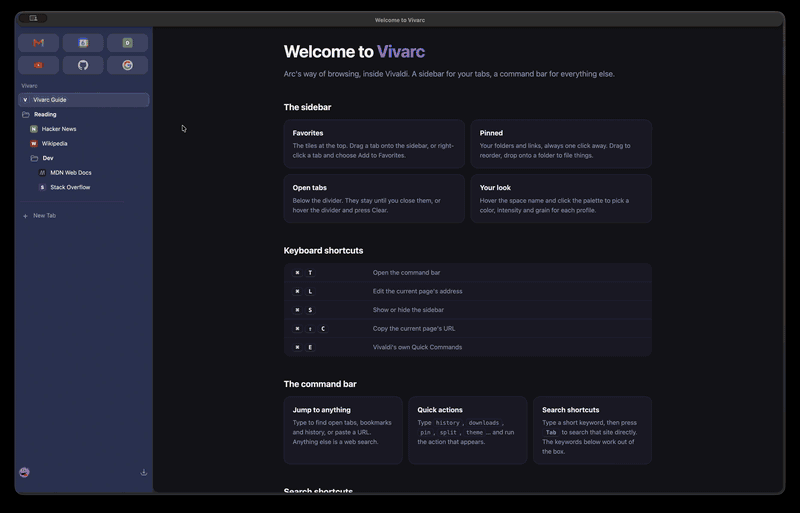
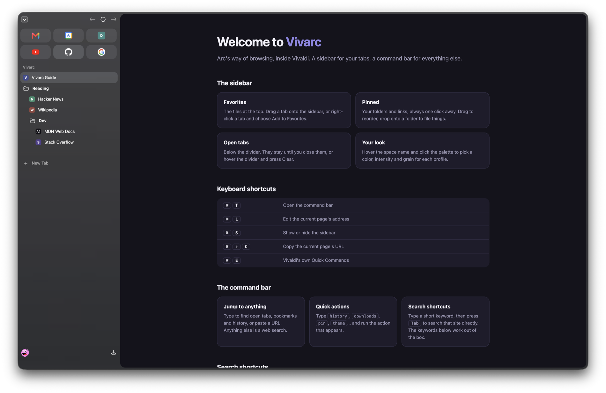
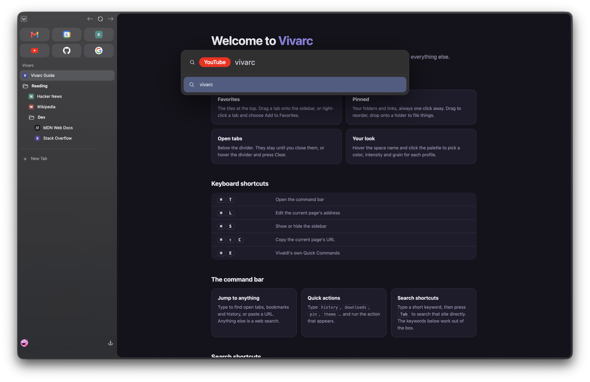
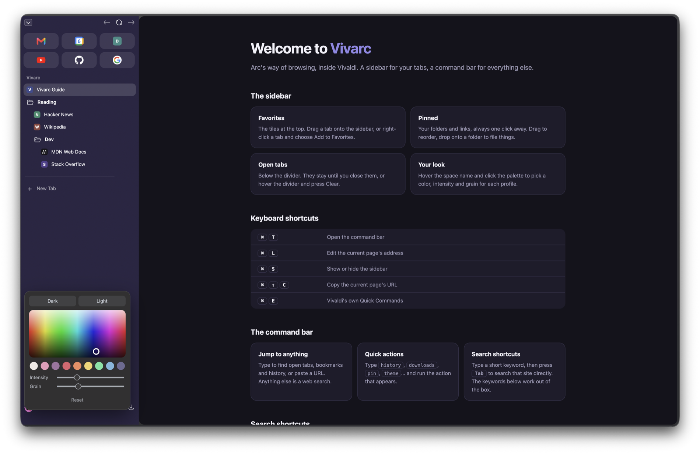

<h1 align="center">Vivarc</h1>

<p align="center">
  <b>Arc's sidebar and command bar, inside Vivaldi.</b><br>
  Favorites, pinned folders and open tabs in one panel. A Cmd+T command bar with quick actions. A theme editor. One command to install, one to remove.
</p>

<p align="center">
  <a href="LICENSE"></a>
  
  
  
</p>

<p align="center">
  
</p>

> **Arc is being discontinued on December 22, 2026**, according to the announcement email The Browser Company sent. If you want to keep the sidebar and command bar workflow somewhere else, Vivarc gives you most of it in Vivaldi, free and open source.

## Install

Quit Vivaldi (Cmd+Q), then:

```sh
git clone https://github.com/KASOGIT/vivarc.git && cd vivarc
./vivarc.py install
```

Open Vivaldi. That's it. Every profile gets the sidebar, and profiles you create later set themselves up the first time they open (no restart). Each profile starts with a few example favorites and pins so you can see how it works, and a new profile opens a short guide page.

Requires macOS, Vivaldi 8.x and Python 3 (included with the Xcode command line tools). macOS may ask you to allow your terminal under **System Settings > Privacy & Security > App Management**, because the script edits `Vivaldi.app`.

## What you get

**One sidebar.** A favorites grid on top, your pinned folders below, a divider with *Clear*, then your open tabs. Drag and drop between all of them, nest folders, rename in place, right-click for everything. Removed items go to Vivaldi's bookmark trash.

<p align="center">
  
</p>

**A command bar on Cmd+T.** It opens over the page you are on. Type to jump to an open tab, a bookmark or a history entry, paste a URL, or search.

<p align="center">
  
</p>

- **Search shortcuts.** Type `yt` then Tab to search YouTube. 18 are built in (`g`, `gm` Gmail, `gd` Drive, `gc` Calendar, `gh`, `so`, `npm`, `mdn`, `li`, `x`, `w`, `r`, `m`, `az`, `tr`, `d`, `b`). The search engine keywords you already set in Vivaldi work too.
- **Quick actions.** Type `history`, `downloads`, `pin`, `theme`, `private`, `guide`... and run it: View History, View Downloads, Pin This Tab, Add to Favorites, Copy Current URL, **Split View** (side by side or top and bottom, like Arc), Duplicate, Mute, New Private Window and more.

**A theme editor.** Hover the space name and click the palette: pick a colour, intensity and grain. Saved per profile, so each one gets its own look.

<p align="center">
  
</p>

**Shortcuts**

| Keys | Does |
|---|---|
| Cmd+T | Command bar |
| Cmd+S | Show or hide the sidebar |
| Cmd+Shift+C | Copy the page URL (with a toast) |
| Cmd+L | Edit the address |
| Cmd+E | Vivaldi's own Quick Commands |

**Also:** an optional link preview (Peek, by [PaRr0tBoY](https://github.com/PaRr0tBoY/Awesome-Vivaldi), downloaded from upstream and verified at install), and an importer for your Arc spaces and site icons.

## Coming from Arc

```sh
./vivarc.py import-arc     # reads Arc's data (read only), writes ~/.vivarc/import/arc-<space>.html and your site icons
```

In each Vivaldi profile: **Cmd+Shift+B > Import Bookmarks and Settings > HTML file**, pick the matching file. Quit Vivaldi and run `./vivarc.py apply` once to include the icons. Arc spaces become Vivaldi profiles.

### Where Vivaldi differs from Arc

- **Spaces are profiles.** Vivaldi has no spaces inside one window. Each Vivaldi profile (Perso, Work...) is its own window with its own bookmarks, logins and Vivarc sidebar. Switch between them with **Cmd+`** (macOS cycles the windows of the active app).
- **Links do not pick a space.** Arc can send a link to a given space; Vivaldi opens links from other apps in whichever profile was used last. The workaround is [Finicky](https://github.com/johnste/finicky), a tiny app that becomes your default browser and routes each link to a profile by domain:
  1. `brew install --cask finicky`, then set Finicky as the default browser in System Settings.
  2. Copy [templates/finicky.js](templates/finicky.js) to `~/.finicky.js` and edit it: one `handlers` entry per space, with the domains you want in it and the profile name as shown in Vivaldi's profile menu.
- **Not built yet:** Boosts, automatic archiving of old tabs, and Arc's share links.

## Keeping it working

A Vivaldi update replaces `Vivaldi.app` and removes the script. Quit Vivaldi, then:

```sh
./vivarc.py apply
./vivarc.py status     # shows what is installed
```

To remove everything: `./vivarc.py uninstall` restores your preferences and `window.html`. Your bookmarks, including the `Vivarc` folder, are left alone.

## Safety

Every file Vivarc edits is backed up in `~/.vivarc/backup/`, existing shortcuts are kept, and `uninstall` restores the original values. The styles ship inside the script, so a Vivaldi update can never leave you with half a UI. No Vivaldi flags are changed. See [docs/HOW-IT-WORKS.md](docs/HOW-IT-WORKS.md) for exactly what changes and how it works.

The command bar sends what you type to DuckDuckGo's autocomplete for suggestions; set `"suggestions": "off"` in `~/.vivarc/config.json` to turn that off.

## Contributing

**Contributions are very welcome, and they make this project better.** Bug reports, ideas, testing on other setups, docs fixes and pull requests all help, and you do not need to be an expert. See [CONTRIBUTING.md](CONTRIBUTING.md) to get started, and open an issue if you want to talk something through first. The notes in [docs/HOW-IT-WORKS.md](docs/HOW-IT-WORKS.md) cover the Vivaldi quirks worth knowing. If Vivarc saves you time, a star on the repo helps others find it.

## Credits and licence

MIT, see [LICENSE](LICENSE). Peek is [VividPeek by PaRr0tBoY and contributors](https://github.com/PaRr0tBoY/Awesome-Vivaldi) (GPL-3.0); it is not part of this repository.

Not affiliated with The Browser Company or Vivaldi Technologies. "Arc" and "Vivaldi" are their owners' trademarks; the names are used only to describe compatibility. A separate project, [VivalArc](https://github.com/tovifun/VivalArc), restyles Vivaldi's tabs with CSS and a theme; Vivarc adds the behaviour (command bar, favorites, importer, installer).
